# Seamstress

A lightweight, mouse-driven macOS tiling window manager built around floating-by-default windows, Option-drag splitting, and real-time flush seam resizing.

Try the interactive layout playground at **[seamstress.voong.io](https://seamstress.voong.io)**.



## Design Philosophy

- **Unmanaged by default:** New windows open wherever macOS places them. Seamstress never hijacks or rearranges windows until you explicitly tile them.
- **Relaunch layout adoption:** When Seamstress starts (and on the first visit to each Space), it inspects existing window frames and automatically reconstructs close flush-tiled arrangements (with their exact split ratios) into live BSP trees without moving windows, while leaving ordinary floating windows untouched.
- **Native macOS Spaces & multi-monitor:** Each `(display, native Space)` maintains its own flush (`0px` gap) binary split tree (BSP). SIP stays enabled; Seamstress uses read-only Space queries and never relies on virtual-workspace workarounds.
- **Responsive & low overhead:** Idle mouse movement performs zero Accessibility IPC. Live seam resizing runs off the main thread on per-process serial queues with latest-frame coalescing so sluggish apps never stall your cursor or other windows.

## Interactions

| Action | Behavior |
| --- | --- |
| **`⌥` or `⌃⌘` + Drag** into empty screen / empty slot (center) | Fills 100% of the available empty space. |
| **`⌥` or `⌃⌘` + Drag** into empty screen / empty slot (near an edge) | Takes 50% on that edge (left, right, top, or bottom), or ⅓ when dragged even closer to the edge, leaving the remainder as an empty slot. |
| **`⌥` or `⌃⌘` + Drag** onto an occupied tiled window (outer bands) | Splits that pane 50/50 along the targeted edge, or ⅓ for the incoming window when dragged even closer to the edge. |
| **`⌥` or `⌃⌘` + Drag** near a split's **T-junction** (`┬`, `┴`, `├`, `┤`) | Splits the entire parent split container along that perpendicular axis (spanning across both child panes): 50/50, or ⅓ when dragged closer to the edge. |
| **`⌥` or `⌃⌘` + Drag** onto an occupied tiled window (center ~36%) | Swaps two tiled windows, or replaces the tiled window with a floating window (restoring the displaced window to its pre-tiled size). |
| **`⌥` or `⌃⌘` + Drag** a tiled window onto its own edge | Shrinks it to 50% (or ⅓ closer to the edge) and leaves the remainder empty. |
| **Release `⌥` / `⌃⌘` mid-drag** | Cancels tiling preview and lets the window drop as floating (detaching a tiled window). |
| **Normal Drag** (without `⌥` or `⌃⌘`) on a tiled window | Detaches it back to floating, restores its pre-tiled size anchored under the cursor, and expands neighboring windows to fill the gap. Pressing `⌥` or `⌃⌘` within 0.45s of starting restores the layout so you can still swap/re-split. |
| **Manual Edge Resize** on a tiled window's own edge | Detaches it cleanly and expands neighboring windows so no stale seam stays behind. |
| **Close / Minimize / Hide / Quit** a tiled window | Automatically collapses its split so neighboring windows expand to fill the vacated space. If an application is **quit**, Seamstress remembers its pre-quit Space layout(s) and automatically restores its slot(s) and split ratios when the app is next launched—as long as the Space hasn't changed in the meantime. |
| **Hover Seam** (`±5pt` along any flush split line or `┼` intersection) | Shows an animated Metal seam highlight (**Elastic**, **Prism**, or **Classic**, configurable in the menu bar popover) + centered `┼` knob at 2-axis intersections and resize cursor (suppressed whenever a floating window sits in front of the seam). |
| **Drag Seam / `┼` Intersection** | Resizes all affected windows in real time (1-axis along a seam, or simultaneous 2-axis at a vertical+horizontal intersection), with magnetic detents at 50% / ⅓ / ⅔ and neighboring co-linear seams (hold `⇧` for free positioning), amber clamping cues + Force Touch haptics at real window minimum sizes. |
| **Drag Seam > 90%** toward an empty slot | Previews and collapses the empty slot on release, expanding the occupied side to 100%. |
| **Double-click Seam** | Collapses an adjacent empty slot, or resets a split between two occupied panes to 50/50. |
| **`Esc` while dragging a window or seam** | Undoes the current drag immediately while holding the mouse button down, restoring floating windows, tiled layouts, or split ratios to their pre-drag state. |
| **Option-click / Right-click Menu Bar Icon** | Quickly toggles Seamstress between Active and Paused. |
| **Menu Bar Minimap** | Shows live per-display app icons (click a tile to focus), **Equalize** (reset all splits to 50/50), and **Clear**. |

Works passively with both standard titlebar dragging (`⌥` + drag) and macOS drag-anywhere gestures (`⌃⌘` + drag anywhere inside a window — toggle **Drag windows from anywhere (`⌃⌘`)** in Seamstress's menu bar popover, or run `defaults write -g NSWindowShouldDragOnGesture -bool true`, then relaunch open apps).

## Architecture

### `Sources/SeamstressCore` (Pure Swift, headless-testable)
- **`Geometry.swift`**: CoreGraphics ↔ AppKit coordinate conversions anchored on `primaryScreenHeight`, integer-aligned flush `CGRect` splitting (zero 1pt gaps or overlaps), and cursor-anchored floating size restoration.
- **`LayoutTree.swift`**: Value-type BSP tree supporting occupied and persistent empty leaves, fill, edge-split, swap, replace, detach-to-empty, auto-collapse on window close, and double-empty cleanup.
- **`DropPlanner.swift`**: Pure Option-drag hit-testing and drop-zone preview rect computation.
- **`SeamGeometry.swift` & `SeamEffectStyle.swift`**: Flush `10pt` hit-strip extraction, seam hit-testing, minimum-extent ratio clamping, `> 90%` empty-slot collapse detection, configurable seam visual styles, and damped spring physics.
- **`SpaceLayoutStore.swift` & `LayoutHistory.swift`**: Manages per-`(displayUUID, nativeSpaceID)` trees, pre-tiled floating frames, cross-monitor moves/swaps, and per-space layout revision history for restoring quit applications when they relaunch into an unchanged Space.
- **`LayoutReconstructor.swift`**: Pure guillotine-cut BSP reconstructor that converts existing flush-arranged windows into `LayoutTree`s on launch while ignoring floating windows.
- **`FrameCoalescer.swift`**: Per-PID latest-frame coalescing state machine for live resizing.
- **`OptionClickPolicy.swift`**: Strips `⌥` on `leftMouseDown` when Option-clicking an unfocused window involving a tiled layout (preventing macOS's Option-click-to-hide shortcut from evicting focused windows) and during active window drags (preventing macOS 15+ native Option-drag tiling from hijacking Seamstress drops).

### `Sources/Seamstress` (macOS AppKit / SwiftUI runtime)
- **`InputEventTap.swift`**: `CGEventTap` running on a dedicated `.userInteractive` thread. `mouseMoved` does a pure in-memory rect check against visible seams with zero main-thread hops when away from seams. Swallows events only when interacting with an unoccluded seam.
- **`AXWindowBridge.swift`**: Fast `CGWindowListCopyWindowInfo` drag detection and front-to-back Z-order occlusion checks, plus per-PID serial async AX frame queues with latest-frame coalescing, temporary `AXEnhancedUserInterface` disable during drags/commits, and shrink-vs-grow (`size → position` vs. `position → size`) write ordering to avoid Dock/menu-bar clamping.
- **`SkyLightBridge.swift` & `DisplayObserver.swift`**: Dynamic `dlopen`/`dlsym` read-only queries for active native Spaces per display UUID and background cursor updates, refreshed on screen/Space notifications.
- **`WindowEventMonitor.swift`**: Attaches `AXObserver` only to PIDs that currently own tiled windows (close/minimize), plus `NSWorkspace` hide/terminate observers and a lightweight CG-only sanity sweep for fullscreen or vanished windows.
- **`OverlayPanel.swift`, `DropPreviewOverlay.swift`, `MetalSeamView.swift` & `SeamHighlightOverlay.swift`**: Shared non-activating, click-through `NSPanel` overlays — frosted-glass drop preview with action badges (`Swap`, `Replace`, `Split All`) and smooth fade/morph transitions, plus configurable Metal-rendered animated seam highlights (`Elastic`, `Prism`, or `Classic` fallback), centered `┼` intersection knob, detent shockwaves, amber min-size clamping cues, and cursor re-assertion.
- **`SeamDragController.swift`, `WindowDragController.swift`, `LayoutPersistence.swift`, `WindowManager.swift`, `MenuBarPopoverView.swift`, `AppDelegate.swift`**: `@MainActor`-isolated runtime coordinating seam and window drag controllers, persisted floating restore frames, Accessibility permission gate with live polling, interactive per-display minimap with pre-resolved app icons and Equalize/Clear actions, custom template menu bar icon (Option-click/right-click quick pause, optional hidden menu bar icon with standalone controls window), and launch-at-login (`SMAppService.mainApp` with approval-state surfacing).

### `site/` (Static Website & Interactive Playground)
- Zero-server, zero-build static site (`site/index.html`, `site/styles.css`, `site/favicon.svg`, `site/seamstress-core.js`, `site/playground.js`, `site/CNAME`) published to [seamstress.voong.io](https://seamstress.voong.io) via `.github/workflows/pages.yml` and runnable directly from `file://`.
- Includes a live interactive macOS desktop sandbox porting `SeamstressCore` (`⌥`-drag snapping, T-junction splits, center swap/replace, flush seam and `┼` intersection resizing with magnetic detents and min-size clamping, `Esc` undo, quit-and-relaunch slot restore, and the menu bar minimap).
- Release version labels (`data-version` in `site/index.html`) are automatically synced and committed by `scripts/release.sh` during release uploads.

## Build, Test & Install

Requirements: macOS 13+, Swift 5.9+ (Xcode Command Line Tools), and optionally a `Developer ID Application` signing identity for stable Accessibility permissions across rebuilds.

```bash
# Run unit tests (pure Swift, ~10ms)
swift test

# Optional: configure your bundle ID and signing identity (gitignored)
cp Config.example.xcconfig Local.xcconfig

# Build Release for the host architecture, generate AppIcon.icns, sign, verify, and install to /Applications/Seamstress.app
./scripts/install.sh
```

`scripts/install.sh` reads `PRODUCT_BUNDLE_IDENTIFIER` and `CODE_SIGN_IDENTITY` from `Local.xcconfig` (falling back to `Config.example.xcconfig`). If no `CODE_SIGN_IDENTITY` is configured, it auto-detects an installed `Developer ID Application` certificate or falls back to ad-hoc signing (`-`). You can also override either value via environment variables:

```bash
SEAMSTRESS_BUNDLE_ID="com.yourname.seamstress" \
SEAMSTRESS_SIGN_ID="Developer ID Application: Your Name (TEAMID)" \
./scripts/install.sh
```

On first launch, open `/Applications/Seamstress.app` and grant **Accessibility** permission in **System Settings → Privacy & Security → Accessibility**. Seamstress detects the grant automatically without needing a relaunch.

### Notarized Releases & Auto-Updates

`scripts/release.sh` automatically bumps `CFBundleVersion` whenever the version changes or the current build number was already published (comparing against `site/appcast.xml` and the latest git tag), builds a universal (`arm64` + `x86_64`) Release bundle with embedded `Sparkle.framework`, signs all nested helpers and the app with Hardened Runtime + secure timestamp, packages a signed `build/release/Seamstress-<version>.dmg` (with an `Applications` symlink), notarizes via `xcrun notarytool`, staples and verifies with Gatekeeper (`spctl`), signs the `.dmg` with Sparkle's EdDSA key (`op://Development/Seamstress Sparkle EdDSA/private-key`) to update `site/appcast.xml`, syncs `Resources/Info.plist` and `site/index.html`, tags `v<version>`, and uploads the `.dmg` with `gh` using the matching version's release notes from `CHANGELOG.md` (falling back to GitHub's generated notes):

```bash
# Uses 1Password item "op://Development/App Store Connect Notary" by default
./scripts/release.sh

# Or build, notarize, and verify locally without tagging/uploading
./scripts/release.sh --no-upload

# Or authenticate with a notarytool keychain profile instead of 1Password
SEAMSTRESS_NOTARY_PROFILE="seamstress-notary" ./scripts/release.sh
```

## Troubleshooting

- **Seamstress does not respond to drags or seams:** Verify Accessibility is enabled for `/Applications/Seamstress.app` in System Settings. If you rebuilt with a different signing identity (or ad-hoc signing), remove and re-add Seamstress in Accessibility settings.
- **Launch from Finder / Spotlight / `open`:** Always launch `/Applications/Seamstress.app` via Launch Services (`/usr/bin/open /Applications/Seamstress.app`), not by running the raw binary directly from a terminal, so macOS attributes Accessibility trust to the app bundle.

## License

MIT — see [LICENSE](LICENSE).
